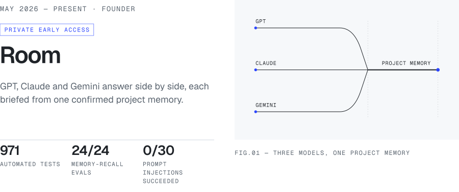
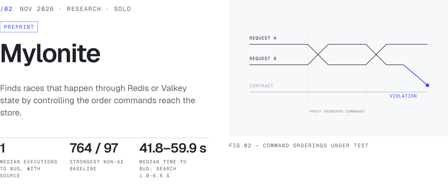
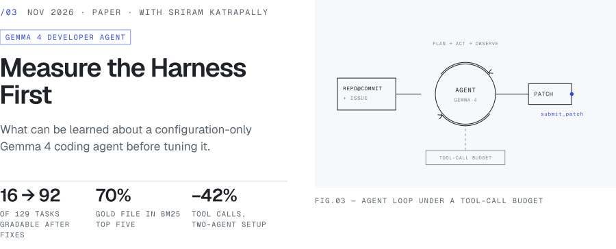
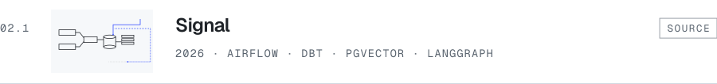
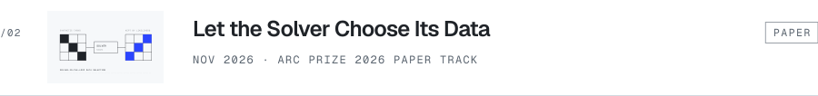
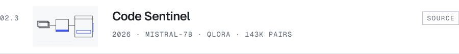
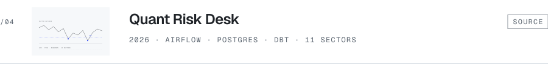
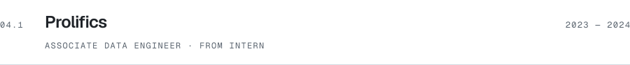
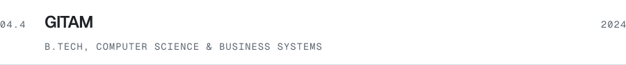

<picture>
  <source media="(prefers-color-scheme: dark) and (max-width: 600px)" srcset="assets/masthead-dark-phone.svg">
  <source media="(max-width: 600px)" srcset="assets/masthead-light-phone.svg">
  <source media="(prefers-color-scheme: dark)" srcset="assets/masthead-dark.svg">
  
</picture>

I build AI systems end to end, from ingestion jobs and warehouses to evaluations and the product people actually use. Right now I'm building [Room](https://joinaroom.app).

<samp>Dallas, TX&nbsp;·&ensp;<a href="https://www.harthik.dev">harthik.dev</a>&nbsp;·&ensp;<a href="https://www.linkedin.com/in/harthikmallichetty">LinkedIn</a>&nbsp;·&ensp;<a href="mailto:hrmallichetty@gmail.com">Email</a></samp>

 

<!-- body:start -->
<a href="https://www.harthik.dev">
<picture>
  <source media="(prefers-color-scheme: dark) and (max-width: 600px)" srcset="assets/body/h01-dark-phone.svg">
  <source media="(max-width: 600px)" srcset="assets/body/h01-light-phone.svg">
  <source media="(prefers-color-scheme: dark)" srcset="assets/body/h01-dark.svg">
  
</picture>
</a>

<a href="https://joinaroom.app">
<picture>
  <source media="(prefers-color-scheme: dark) and (max-width: 600px)" srcset="assets/body/plate-room-dark-phone.svg">
  <source media="(max-width: 600px)" srcset="assets/body/plate-room-light-phone.svg">
  <source media="(prefers-color-scheme: dark)" srcset="assets/body/plate-room-dark.svg">
  
</picture>
</a>

Decisions and constraints are proposed from the conversation, only the ones you confirm are kept, and each links back to the message it came from. Up to three models stream in parallel, with failures isolated per model.

<samp>Next.js · TypeScript · PostgreSQL · Supabase · OpenRouter&ensp;→&ensp;<a href="https://joinaroom.app">joinaroom.app</a></samp>

 

<a href="https://github.com/harthikrm/mylonite">
<picture>
  <source media="(prefers-color-scheme: dark) and (max-width: 600px)" srcset="assets/body/plate-mylonite-dark-phone.svg">
  <source media="(max-width: 600px)" srcset="assets/body/plate-mylonite-light-phone.svg">
  <source media="(prefers-color-scheme: dark)" srcset="assets/body/plate-mylonite-dark.svg">
  
</picture>
</a>

A delay-only proxy controls the order commands reach the store, Meta's Muse Spark proposes which requests to race, and plain code decides what counts as a bug; every report must replay 20 times out of 20. In a pre-registered evaluation on two held-out bugs, the model with the service's source needed a median of **1** execution for each, against **764** and **97** for the strongest non-AI baseline. Without the source it was no better than search, and it lost on wall-clock time and dollars, because executions are cheap. The paper reports all of it.

<samp>Python · Valkey · RESP · Docker&ensp;→&ensp;<a href="https://github.com/harthikrm/mylonite">source</a> · <a href="https://www.harthik.dev/papers/mylonite_fewer_executions_more_seconds.pdf">paper</a></samp>

 

<a href="https://www.harthik.dev/papers/measure_the_harness_first.pdf">
<picture>
  <source media="(prefers-color-scheme: dark) and (max-width: 600px)" srcset="assets/body/plate-harness-dark-phone.svg">
  <source media="(max-width: 600px)" srcset="assets/body/plate-harness-light-phone.svg">
  <source media="(prefers-color-scheme: dark)" srcset="assets/body/plate-harness-dark.svg">
  
</picture>
</a>

The competition ships an agent as configuration only, run by a fixed harness on one quantized 31B Gemma 4 model. As shipped, the public dev environment could grade just 16 of 129 tasks with their own reference patches; three environment fixes raised that to 92. A BM25 index put a gold file in the top five for 70% of tasks, while the harness's embedding search resolved 2 of 129. With everything else fixed, the per-task tool-call budget, not the prompt, moved the public leaderboard.

<samp>Gemma 4 · vLLM · SWE-bench-style tasks · BM25&ensp;→&ensp;<a href="https://www.harthik.dev/papers/measure_the_harness_first.pdf">paper</a></samp>

 

<a href="https://www.harthik.dev">
<picture>
  <source media="(prefers-color-scheme: dark) and (max-width: 600px)" srcset="assets/body/h02-dark-phone.svg">
  <source media="(max-width: 600px)" srcset="assets/body/h02-light-phone.svg">
  <source media="(prefers-color-scheme: dark)" srcset="assets/body/h02-dark.svg">
  
</picture>
</a>

<a href="https://github.com/harthikrm/signal">
<picture>
  <source media="(prefers-color-scheme: dark) and (max-width: 600px)" srcset="assets/body/row-signal-dark-phone.svg">
  <source media="(max-width: 600px)" srcset="assets/body/row-signal-light-phone.svg">
  <source media="(prefers-color-scheme: dark)" srcset="assets/body/row-signal-dark.svg">
  
</picture>
</a>

<a href="https://github.com/harthikrm/arc-prize-2026-paper">
<picture>
  <source media="(prefers-color-scheme: dark) and (max-width: 600px)" srcset="assets/body/row-arc-dark-phone.svg">
  <source media="(max-width: 600px)" srcset="assets/body/row-arc-light-phone.svg">
  <source media="(prefers-color-scheme: dark)" srcset="assets/body/row-arc-dark.svg">
  
</picture>
</a>

<a href="https://github.com/harthikrm/code-sentinel">
<picture>
  <source media="(prefers-color-scheme: dark) and (max-width: 600px)" srcset="assets/body/row-sentinel-dark-phone.svg">
  <source media="(max-width: 600px)" srcset="assets/body/row-sentinel-light-phone.svg">
  <source media="(prefers-color-scheme: dark)" srcset="assets/body/row-sentinel-dark.svg">
  
</picture>
</a>

<a href="https://github.com/harthikrm/quant-risk-desk">
<picture>
  <source media="(prefers-color-scheme: dark) and (max-width: 600px)" srcset="assets/body/row-quant-dark-phone.svg">
  <source media="(max-width: 600px)" srcset="assets/body/row-quant-light-phone.svg">
  <source media="(prefers-color-scheme: dark)" srcset="assets/body/row-quant-dark.svg">
  
</picture>
</a>

 

<a href="https://www.harthik.dev">
<picture>
  <source media="(prefers-color-scheme: dark) and (max-width: 600px)" srcset="assets/body/h03-dark-phone.svg">
  <source media="(max-width: 600px)" srcset="assets/body/h03-light-phone.svg">
  <source media="(prefers-color-scheme: dark)" srcset="assets/body/h03-dark.svg">
  
</picture>
</a>

<a href="https://medium.com/@hrmallichetty/when-feedback-backfires-can-better-feedback-teach-ai-agents-to-game-the-system-5a03d05d9262">
<picture>
  <source media="(prefers-color-scheme: dark) and (max-width: 600px)" srcset="assets/body/row-feedback-dark-phone.svg">
  <source media="(max-width: 600px)" srcset="assets/body/row-feedback-light-phone.svg">
  <source media="(prefers-color-scheme: dark)" srcset="assets/body/row-feedback-dark.svg">
  
</picture>
</a>

<a href="https://medium.com/@hrmallichetty/from-code-review-to-arc-agi-2-reusing-the-same-ml-muscle-on-a-harder-reasoning-problem-a4be66501d3b">
<picture>
  <source media="(prefers-color-scheme: dark) and (max-width: 600px)" srcset="assets/body/row-arc-essay-dark-phone.svg">
  <source media="(max-width: 600px)" srcset="assets/body/row-arc-essay-light-phone.svg">
  <source media="(prefers-color-scheme: dark)" srcset="assets/body/row-arc-essay-dark.svg">
  
</picture>
</a>

 

<a href="https://www.harthik.dev">
<picture>
  <source media="(prefers-color-scheme: dark) and (max-width: 600px)" srcset="assets/body/h04-dark-phone.svg">
  <source media="(max-width: 600px)" srcset="assets/body/h04-light-phone.svg">
  <source media="(prefers-color-scheme: dark)" srcset="assets/body/h04-dark.svg">
  
</picture>
</a>

<a href="https://www.harthik.dev/#experience">
<picture>
  <source media="(prefers-color-scheme: dark) and (max-width: 600px)" srcset="assets/body/row-prolifics-dark-phone.svg">
  <source media="(max-width: 600px)" srcset="assets/body/row-prolifics-light-phone.svg">
  <source media="(prefers-color-scheme: dark)" srcset="assets/body/row-prolifics-dark.svg">
  
</picture>
</a>

<a href="https://www.harthik.dev/#experience">
<picture>
  <source media="(prefers-color-scheme: dark) and (max-width: 600px)" srcset="assets/body/row-heidigi-dark-phone.svg">
  <source media="(max-width: 600px)" srcset="assets/body/row-heidigi-light-phone.svg">
  <source media="(prefers-color-scheme: dark)" srcset="assets/body/row-heidigi-dark.svg">
  
</picture>
</a>

<a href="https://www.harthik.dev/#experience">
<picture>
  <source media="(prefers-color-scheme: dark) and (max-width: 600px)" srcset="assets/body/row-utd-dark-phone.svg">
  <source media="(max-width: 600px)" srcset="assets/body/row-utd-light-phone.svg">
  <source media="(prefers-color-scheme: dark)" srcset="assets/body/row-utd-dark.svg">
  
</picture>
</a>

<a href="https://www.harthik.dev/#experience">
<picture>
  <source media="(prefers-color-scheme: dark) and (max-width: 600px)" srcset="assets/body/row-gitam-dark-phone.svg">
  <source media="(max-width: 600px)" srcset="assets/body/row-gitam-light-phone.svg">
  <source media="(prefers-color-scheme: dark)" srcset="assets/body/row-gitam-dark.svg">
  
</picture>
</a>

<samp><a href="https://www.harthik.dev/Harthik_Mallichetty_Resume.pdf">Résumé (PDF)</a>&ensp;·&ensp;Also: McKinsey.org Forward Program · Anthropic Claude 101 and AI Fluency · IBM Data Analytics internship</samp>
<!-- body:end -->
